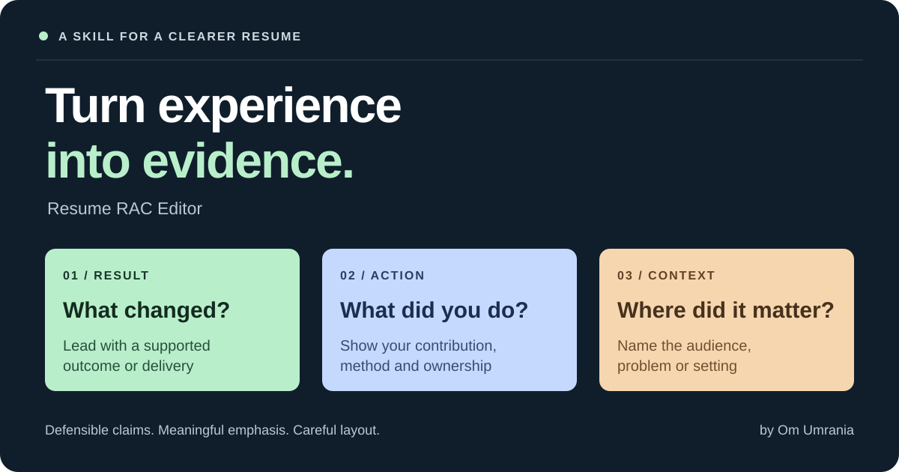
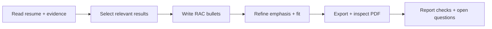

<p align="center">
  
</p>

<p align="center">
  <a href="SKILL.md">Read the skill</a> · <a href="#get-started">Get started</a> · <a href="EXAMPLES.md">See examples</a> · <a href="LICENSE">MIT licence</a>
</p>

# Your experience. A clearer story.

An AI skill for turning resume bullets into **Result → Action → Context**, with defensible claims, meaningful bolding and careful layout checks.

Built for people who have done good work and want their resume to show it clearly.

## See the difference

**Before**

> Responsible for preparing weekly reports using Excel

**After**

> **Saved 12 reporting hours monthly** by automating weekly Excel reports for a regional sales team

| Result | Action | Context |
| :--- | :--- | :--- |
| Saved 12 hours monthly | Automated weekly Excel reports | Regional sales team |

*Fictional example. Use a metric only when your own evidence supports it.*

## What it improves

| Evidence | Writing | Presentation |
| :--- | :--- | :--- |
| Checks the source behind a claim | Leads with a concrete result | Bolds complete, meaningful phrases |
| Preserves units and team ownership | Explains your contribution | Aims for balanced, single-line bullets |
| Flags unresolved metrics | Adds the audience or problem | Verifies the exported PDF visually when tools allow |

No measured business result? Use a truthful delivery or usage result. A completed prototype is a valid result. An invented revenue impact is not.

## Get started

### Codex

Clone the repository into your personal skills directory:

```bash
mkdir -p ~/.codex/skills
git clone https://github.com/om-umrania/resume-rac-editor.git ~/.codex/skills/resume-rac-editor
```

Start a new session, attach or reference your editable resume and supporting evidence, then paste:

```text
Use $resume-rac-editor to refine my resume for [target role].
Preserve my template and typography. Use only supported claims,
write Result → Action → Context bullets, and bold meaningful phrases.
Flag missing evidence separately. If export and rendering tools are
available, verify the final PDF for layout and page count.
```

The clone command expects the destination folder to be absent. If you already have this skill installed, inspect it before replacing it.

### Other AI assistants

Open [SKILL.md](SKILL.md), copy its contents into your assistant as instructions, and attach your resume. Native skill installation depends on your assistant. The writing guidance can be used directly as a prompt.

This repository contains instructions, not an executable resume builder. Document editing, export and visual checks depend on the tools available in your assistant.

## Give it the right inputs

1. **Your resume:** preferably an editable document, plus the existing PDF for layout reference
2. **Your target:** a role title or job description
3. **Your evidence:** project notes, measured outcomes, scope, dates and your actual contribution
4. **Your constraints:** page limit, template, sections to edit and anything to preserve

Share only information you are comfortable providing to your chosen AI service. Keep personal resumes and private evidence out of public repositories.

## A few useful prompts

**Rewrite a single experience**

```text
Use the resume RAC skill on this experience only. Give me a recommended
version and explain any claim that needs confirmation. Do not invent metrics.
```

**Improve emphasis and fit**

```text
Review these bullets for meaningful phrase bolding and balanced line length.
Preserve the font, margins and template. If you cannot inspect the rendered
document, say which layout checks are still unverified.
```

**Review before sending**

```text
Audit my resume for unsupported outcomes, missing time units, overstated
ownership, repeated claims and awkward wrapping. Separate verified findings
from checks you could not perform.
```

## How the review works



The default is a one-page resume with complete, single-line bullets. Essential evidence takes priority over forcing text to fit. The skill preserves the existing template and asks the assistant to disclose any layout checks it cannot complete.

## Inside this repository

| File | Purpose |
| :--- | :--- |
| [SKILL.md](SKILL.md) | Full editing and verification instructions |
| [agents/openai.yaml](agents/openai.yaml) | Codex display metadata and default prompt |
| [EXAMPLES.md](EXAMPLES.md) | Fictional examples, evidence checks and common mistakes |
| [assets/rac-cover.svg](assets/rac-cover.svg) | Original README artwork |
| [LICENSE](LICENSE) | MIT permission to use, modify and share |

Created by [Om Umrania](https://github.com/om-umrania). Adapt it to your own workflow and share it with someone working on their resume.
